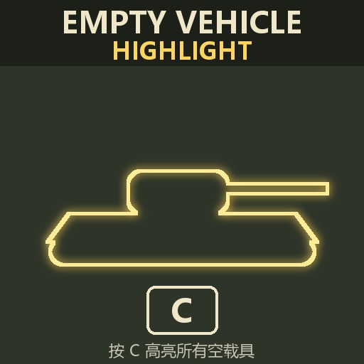

# Empty Vehicle Highlight（空载具高亮）

Call to Arms – Gates of Hell: Ostfront 模组。按原版“高亮地面物品”键（默认 **C**）时，同时描出所有**无人载具**的轮廓（坦克、汽车、装甲车、火炮、飞机、船只……），鼠标悬停显示载具名称。

A mod for *Call to Arms – Gates of Hell: Ostfront*. Pressing the vanilla "highlight items" key (**C**) also outlines every crewless vehicle; hovering shows the vehicle name.

**Steam Workshop: https://steamcommunity.com/sharedfiles/filedetails/?id=3831496369**



## 原理

引擎的 C 键高亮只对非 `actor` 的物品实体生效，载具是 `actor`，无法直接被点亮。本模组：

1. 在所有基于 `/properties/vehicle.ext` 的实体上挂脚本：载具无人（`not operatable`）且在小地图上显示（`able minimap`、无 `destroyed` 标签、无 `no_minimap_view` 属性）时，每 3 秒在载具 `basis` 骨骼处生成一个**替身**，替身存活 3.3 秒后自删；有人上车后最多 3 秒消失。
2. 每种载具一个替身：同一模型、带 stuff extender 和专属物品，所有碰撞体关闭，因此能被 C 点亮、悬停显示名称，但不可拾取、不可选中、不挡子弹。
3. 替身、物品、名称和脚本块由 `tools/gen_proxies.py` 从当前安装的游戏数据生成（当前 822 种载具）。

详细的引擎分析见 [docs/NOTES.md](docs/NOTES.md)，Workshop 发布材料见 [docs/WORKSHOP.md](docs/WORKSHOP.md)。

## 目录

```
mod/empty_vehicle_highlight/     模组本体（即上传 Workshop 的目录）
  mod.info
  resource/set/interaction_entity/
    entity.set                         原版文件 + 两行 include（生成）
    empty_vehicle_highlight.inc        核心逻辑（手写）
    empty_vehicle_highlight_proxies.inc 每种载具的生成块（生成）
  resource/set/stuff/special/evh_*     替身物品（生成）
  resource/entity/-vehicle/**/evh_*.def 替身实体（生成）
  localizations/{default,ch}/...       替身悬停名称（生成）
tools/
  gen_proxies.py   重新生成所有生成文件
  install.py       复制到游戏 mods 目录
  check_log.py     扫描 game.log 中与本模组相关的报错
```

只有 `mod.info` 和 `empty_vehicle_highlight.inc` 是手写的，其余文件都由脚本生成，不要手改。

## 维护流程

需要 Python 3.9+，无第三方依赖。游戏不在默认路径时先设置环境变量 `GOH_DIR`。

```bash
# 游戏更新或新增载具后
python tools/gen_proxies.py     # 重新生成
python tools/install.py         # 装到游戏 mods 目录
# 进游戏测试后
python tools/check_log.py
```

游戏版本超出 `mod.info` 中 `maxGameVersion` 后，模组会被判定不兼容，需要修改版本号并重新上传。

## 已知限制

- 替身只复制载具的偏航和俯仰，不复制侧倾；横向斜坡上会略有错位。
- 替身的炮塔、舱门是默认姿态，弃车时炮塔转过的话这部分轮廓会对不上。
- 覆盖了原版 `set/interaction_entity/entity.set`，与其他同样覆盖该文件的模组冲突。
- 未测试联机。

## License

[MIT](LICENSE)。本仓库只包含模组脚本和生成器；游戏本体及其资源版权归 Barbedwire Studios / Digitalmindsoft 所有。
